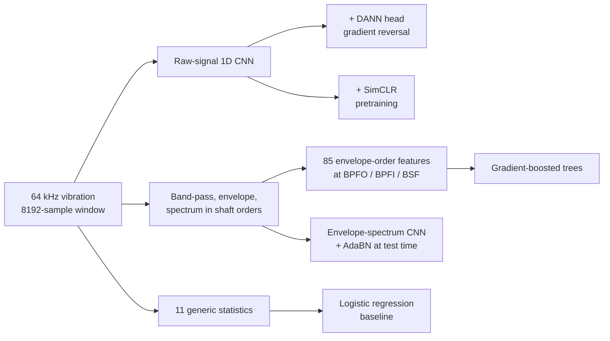

# Leakage-Safe Bearing Fault Diagnosis: Cross-Domain Generalization

ME G545 course project (Aryan). The question: when a bearing fault classifier is tested on
**bearings it has never seen**, with no data leakage between training and test, does deep learning
beat a simple model, and what actually makes a model transfer to a new bearing?

**Short answer.** Under a leakage-safe split, none of the deep models we trained (a 1D CNN, plus
domain-adversarial training, contrastive pretraining, an envelope-spectrum CNN and test-time
BatchNorm adaptation) beat logistic regression. What did help was changing the **input**: features
read at the bearing's physical fault frequencies (envelope-order features), with gradient-boosted
trees. That gain holds across 10 different held-out bearing sets (pre-registered test, p = 0.004).
A later data audit found a recording artifact and a training-set mismatch; fixing those gave the
best benchmark score, 0.590 macro-F1 against 0.508 for the baseline, but that step was chosen after
looking at the data and is reported as exploratory.

| Document | What it holds |
|---|---|
| [PLAN.md](PLAN.md) | Original plan, research questions and leakage rules |
| [docs/literature.md](docs/literature.md) | Phase 0: every number in the proposal checked against its source |
| [docs/benchmark-protocol.md](docs/benchmark-protocol.md) | How the benchmark (Knap et al., 2026) splits, windows and scores |
| [results/reproduction.md](results/reproduction.md) | Phase 1: baselines reproduced, leaky vs leakage-safe split |
| [results/adaptation.md](results/adaptation.md) | Phase 2: domain adaptation (DANN, SimCLR); negative result |
| [results/novel.md](results/novel.md) | Phase 3: envelope-order features, envelope CNN, AdaBN; main result |
| [results/explore.md](results/explore.md) | Phase 4: data audit and fixes; best score, exploratory |
| [docs/progress-log.md](docs/progress-log.md) | Dated log of every working session |
| [docs/DNNpresentation.pptm](docs/DNNpresentation.pptm) | Original proposal slides |

## 1. The problem: data leakage

A vibration recording is cut into many short windows. If windows are shuffled and then split, the
test set holds windows from the same recording, or the same physical bearing, as the training set.
The model can then recognize *the bearing* instead of *the fault*, and scores look excellent.
Leakage of this kind has been documented in 294 papers across 17 fields (Kapoor & Narayanan,
*Patterns*, 2023), and bearing-diagnosis reviews report splitting problems in most published work
(see [docs/literature.md](docs/literature.md) for exactly what each source says).

We measured the effect directly on our data (Phase 1): with the same models, letting the test
bearings appear in training lifts macro-F1 from **0.388 to 0.841** (logistic regression) and from
**0.315 to 0.999** (1D CNN). On seen bearings the CNN wins; on unseen bearings it loses. A leaky
split would have reversed the conclusion.

## 2. The dataset, from the ground up

We use the **Paderborn University (PU) bearing dataset** (Lessmeier et al., 2016), as packaged by
the leakage-safe benchmark of Knap, Jachymczyk & Lalik (PHM Society Europe, 2026). CWRU is also
downloaded and its splits checked, but every experiment below is on PU.

**What a bearing fault is.** A rolling bearing has an outer ring (fixed), an inner ring (turns with
the shaft) and balls between them. A crack or pit on a ring makes every ball that rolls over it
produce a small impact. Those impacts repeat at a rate fixed by the bearing's geometry and the
shaft speed:

| Fault location | Impact rate (PU's 6203 bearing) | Name |
|---|---|---|
| Outer ring | 3.05 × shaft speed | BPFO |
| Inner ring | 4.95 × shaft speed | BPFI |
| Ball | 2.00 × shaft speed | BSF |

These rates depend only on the bearing *type*, not on which individual bearing is mounted, which
is why they are a good candidate for something that transfers to an unseen bearing.

**What was recorded.** A test rig (electric motor, shaft, test bearing, load) runs 32 individual
6203 ball bearings. An accelerometer on the bearing housing records vibration at **64 kHz**; the
two motor phase currents are recorded too. Each recording is **4 seconds** long, and each bearing
has 20 recordings in each of **4 operating conditions**: N15_M07_F10 (1500 rpm, 0.7 Nm load
torque, 1000 N radial force), N09_M07_F10 (900 rpm), N15_M01_F10 (0.1 Nm) and N15_M07_F04 (400 N).

**The 32 bearings.**

| Group | Bearings | Count |
|---|---|---|
| Healthy | K001 to K006 | 6 |
| Artificial damage (EDM, drilled, engraved) | KA01, KA03, KA05–KA09, KI01, KI03, KI05, KI07, KI08 | 12 |
| Real damage, outer ring (from accelerated lifetime tests) | KA04, KA15, KA16, KA22, KA30 | 5 |
| Real damage, inner ring | KI04, KI14, KI16, KI17, KI18, KI21 | 6 |
| Real damage, multiple (inner and outer) | KB23, KB24, KB27 | 3 |

**Classes (4):** healthy, inner ring, outer ring, multiple damage.

**The task we target: PU Cross-Bearing Instance.** Four whole bearings are held out for testing:
K001 (healthy), KA30 (outer), KI21 (inner), KB23 (multiple). The model trains on the other 28 and
is scored with **macro-F1** (F1 per class, averaged, so each class counts equally). It is the one
scenario of six in the benchmark where logistic regression (0.355) beat the best deep model
(0.326), which is why we chose it.

**Windows.** Each recording is cut into windows of 8192 samples (0.128 s). Windows are cut only
*after* whole bearings are assigned to train or test, and `lsbfd.splits` fails if any bearing or
recording appears on both sides.

**Rotated folds.** Four test bearings are a small sample: one bearing flipping changes the score a
lot. From Phase 3 on, every method is also scored on 9 more held-out sets (one real-damage bearing
per class plus one healthy bearing, fixed seed), giving **10 folds**, and compared with a paired
Wilcoxon test.

## 3. Leakage-safety rules (every experiment)

1. Split by bearing first, then cut windows. Never window first and split randomly.
2. Scalers and feature statistics are fitted on training bearings only.
3. Hyperparameters and model choice never look at the test bearings (source-only validation,
   or cross-validation grouped by bearing inside the training set).
4. Each phase's protocol and judging rule were committed **before** its results.
5. Deep models: 3 seeds, mean ± std. Feature models are deterministic, so fold-to-fold spread is
   the uncertainty.

## 4. Architectures that matter



| Model | Input | What it is | Why it was tried |
|---|---|---|---|
| **Logistic regression** (baseline) | 11 generic statistics per window (RMS, kurtosis, crest factor, spectral centroid, ...) | Linear classifier from the benchmark (pdm-bench) | The bar to beat |
| **1D CNN** (deep baseline) | Raw 8192-sample window | pdm-bench's `CNN1D`, unchanged: stacked 1D convolutions → 128-d feature → classifier | The benchmark's deep model |
| **DANN** | Raw window | Same CNN plus a second head that tries to predict *which bearing* a window came from; a gradient-reversal layer trains the features to make that impossible (Ganin & Lempitsky, 2015). Our variant only compares bearings within the same fault class | Remove bearing identity from the features |
| **SimCLR + fine-tuning** | Raw window | Contrastive pretraining of the CNN on augmented windows (gain, polarity, shift, noise, time mask), then supervised fine-tuning | Learn features robust to nuisance changes |
| **Envelope-order features + gradient-boosted trees** (main model) | 85 features: in 5 frequency bands, the envelope-spectrum level at harmonics 1–3 of BPFO, BPFI, BSF, shaft orders 1–2 and inner-ring sidebands, plus band energy and envelope kurtosis | `HistGradientBoostingClassifier`, 200 trees, balanced class weights | Classical envelope analysis: read the signal exactly where the fault physics puts it, in units of shaft speed so all speeds line up |
| **Envelope CNN + AdaBN** | Full log envelope-order spectrum (5 bands × 395 orders) | 3 conv layers (32, 64, 64 channels) + small classifier; AdaBN re-estimates BatchNorm statistics on each unseen bearing's unlabeled windows | Let a network learn which peaks matter; adapt at test time for free |

Envelope analysis in one line: band-pass the vibration around a resonance, take the magnitude of
the analytic signal (the "envelope", which traces the train of impacts), and take its spectrum. A
fault shows up as peaks at its impact rate and harmonics. Code: [src/lsbfd/envelope.py](src/lsbfd/envelope.py).

## 5. Results

All numbers are macro-F1 on unseen bearings, vibration input only (dropping the motor currents
helped every model; see Phase 1).

### Benchmark split (K001, KA30, KB23, KI21)

| Method | Macro-F1 | Status |
|---|---|---|
| Logistic regression, pdm-bench (paper: 0.355 with currents) | **0.508** (single run) | Baseline |
| 1D CNN, pdm-bench (paper: 0.326 with currents) | 0.436 ± 0.023 (3 seeds) | Baseline |
| CNN, our trainer, 20 epochs (control for Phase 2) | 0.404 ± 0.027 | Core |
| + SimCLR pretraining | 0.408 ± 0.034 | Core, no gain |
| + DANN, within-class bearing adversary | 0.348 ± 0.013 | Core, hurts |
| Envelope CNN | 0.318 ± 0.003 | Core, fails |
| Envelope CNN + AdaBN per test bearing (uses unlabeled test data) | 0.393 ± 0.009 | Core |
| Envelope features + boosted trees | 0.490 | Core (pre-registered) |
| Envelope features + boosted trees, real-damage training, despiked | **0.590** | Exploratory |

### Across 10 held-out bearing sets (the main evidence)

| Method | Macro-F1 (10 folds) | vs. LR on generic features |
|---|---|---|
| LR, generic features | 0.355 ± 0.101 | reference |
| Boosted trees, generic features | 0.381 ± 0.093 | +0.026, 5 of 10 folds, p = 0.63 |
| LR, envelope-order features | 0.448 ± 0.098 | +0.093, 8 of 10, p = 0.027 |
| **Boosted trees, envelope-order features** | **0.528 ± 0.100** | **+0.174, 9 of 10, p = 0.004** |
| Boosted trees, envelope, real-damage training, despiked (exploratory) | 0.570 ± 0.091 | +0.041 over the row above, 7 of 10, p = 0.027 |

### What we conclude, and how strongly

1. **Leakage changes the answer** (Phase 1). Seen-bearing scores of 0.84–0.999 drop to 0.32–0.39
   on unseen bearings.
2. **Changing the deep model's training objective did not help** (Phase 2). SimCLR equals the
   control; DANN is worse. Source-only model selection also failed: the DANN setting that led
   validation by 0.23 was the worst on test.
3. **Physics-informed input transferred** (Phase 3, pre-registered). Swapping generic features for
   envelope-order features, with the model fixed, adds +0.147 (trees) and +0.093 (LR) over 10
   folds. Gains are in the outer- and inner-ring classes, as the physics predicts. On the four
   benchmark bearings alone it scores 0.490, just under 0.508, so the stricter fold-0 criterion
   was **not** met.
4. **The data itself limits transfer** (Phase 4, exploratory). A 100 Hz / 52.5 Hz spike train that
   is not bearing physics appears in most healthy and artificial-damage bearings, so generic
   statistics partly learn the artifact. Training on healthy and real-damage bearings only, with
   despiked input, gives 0.590 on the benchmark split. The same training-set change also lifts
   generic-feature trees (to 0.462 over 10 folds), so part of that gain is the training set, not
   the features.
5. **Unsolved:** the "multiple damage" class (KB27 is never recognized) and healthy bearings
   without the artifact (K005, K002). The dataset authors label KB bearings by their dominant
   damage; with their 3-class labels the same model reaches 0.756 over 10 folds.

**Limitations.** One dataset (PU) and one scenario; three seeds for deep models; Phase 2 used 20
training epochs to fit free GPU time; rotated folds share bearings, so p-values are indicative;
the Phase 4 changes were chosen after a data audit.

## 6. Core vs exploratory work

| Status | Code | Results |
|---|---|---|
| Core: leakage-safe splits and checks | [src/lsbfd/splits.py](src/lsbfd/splits.py), [tests/test_splits.py](tests/test_splits.py) | [results/splits/](results/splits/) |
| Core: Phase 1 reproduction | [scripts/phase1_reproduce.sh](scripts/phase1_reproduce.sh), [src/lsbfd/run_variant.py](src/lsbfd/run_variant.py) | [results/reproduction.md](results/reproduction.md) |
| Core: Phase 2 domain adaptation | [src/lsbfd/adapt.py](src/lsbfd/adapt.py), [src/lsbfd/select.py](src/lsbfd/select.py), [scripts/phase2_adapt.sh](scripts/phase2_adapt.sh) | [results/adaptation.md](results/adaptation.md) |
| Core: Phase 3 envelope features, envelope CNN, AdaBN | [src/lsbfd/envelope.py](src/lsbfd/envelope.py), [src/lsbfd/novel.py](src/lsbfd/novel.py), [scripts/phase3_novel.sh](scripts/phase3_novel.sh) | [results/novel.md](results/novel.md), [results/phase3_tables.md](results/phase3_tables.md) |
| Exploratory: Phase 4 data audit and fixes | [src/lsbfd/explore.py](src/lsbfd/explore.py) | [results/explore.md](results/explore.md), [results/explore_tables.md](results/explore_tables.md) |
| Side checks (reported in the phase files, not headline results) | UDA DANN, CV-tuned trees, bagging, operating condition as input, recording-level voting, 3-class labels | in the files above |

## 7. Reproduce

Python 3.11–3.13. Raw data lands in `data/raw/` (git-ignored); download scripts record SHA-256
checksums in `data/checksums/` and verify them on later runs.

```bash
python3.11 -m venv .venv && . .venv/bin/activate
bash setup.sh                      # pinned libraries + pdm-bench benchmark code
cp .env.example .env               # set WORKSPACE to <repo>/data/raw
python -m pytest -q                # split, adaptation and feature tests
```

**Phase 1: baselines** (full PU download, `data/download_pu.sh`; GPU for the CNN)
```bash
python -m lsbfd.splits                      # leakage report for all six scenarios
bash scripts/phase1_reproduce.sh vib-lr     # LR, vibration only (also: lr, leaky-lr)
bash scripts/phase1_reproduce.sh vib-cnn 41 # CNN, repeat for 42, 43 (also: cnn, leaky-cnn)
python -m lsbfd.summarize runs/phase1
```

**Vibration cache for Phases 2–4** (one bearing at a time, ~2.6 GB, works on Kaggle)
```bash
export CACHE=$PWD/data/processed
bash scripts/prepare_pu_cache.sh
```

**Phase 2: domain adaptation** (GPU, ~25 GPU hours in total)
```bash
bash scripts/phase2_adapt.sh val            # source-only validation grid
bash scripts/phase2_adapt.sh select         # fixed selection rule
bash scripts/phase2_adapt.sh test 41        # repeat for 42, 43
```

**Phase 3: envelope features (CPU) and envelope CNN (GPU)**
```bash
bash scripts/phase3_novel.sh features       # envelope-order feature cache
bash scripts/phase3_novel.sh ml             # LR + trees, 10 folds -> main result
bash scripts/phase3_novel.sh cnn            # envelope CNN + AdaBN, seeds 41-43
```

**Phase 4: best configuration (exploratory)** (needs the Phase 3 runs for the comparison table)
```bash
python -m lsbfd.explore features --cache $CACHE --clip 4 --tag clip4
python -m lsbfd.explore ml --env $CACHE/env_clip4 --train real --tag clip4_real
python -m lsbfd.explore table               # -> results/explore_tables.md
```

Kaggle step-by-step notes for Phases 2–4: [docs/kaggle.md](docs/kaggle.md). Every run saves its config,
git commit, seed and held-out bearings next to its scores.

## References

- Knap, Jachymczyk & Lalik (2026). Leakage-safe cross-domain benchmark on CWRU and PU. PHM Society European Conference.
- Lessmeier, Kimotho, Zimmer & Sextro (2016). Condition monitoring of bearing damage in electromechanical drive systems by using motor current signals of electric motors: a benchmark data set for data-driven classification. PHM Society European Conference.
- Ganin & Lempitsky (2015). Unsupervised domain adaptation by backpropagation. ICML.
- Chen, Yang, Xue, Huang, Ferrero & Wang (2023). Deep transfer learning for bearing fault diagnosis: a systematic review since 2016. IEEE TIM 72, 3508221.
- Chen, Kornblith, Norouzi & Hinton (2020). A simple framework for contrastive learning of visual representations (SimCLR). ICML.
- Li et al. (2016). Revisiting batch normalization for practical domain adaptation (AdaBN).
- Kapoor & Narayanan (2023). Leakage and the reproducibility crisis in machine-learning-based science. *Patterns* 4, 100804.
- Vieira, Bauler, Rosa & Silva (2026). Towards a more realistic evaluation of machine learning models for bearing fault diagnosis. Mechanical Systems and Signal Processing.

Full summaries and verified page/table numbers: [docs/literature.md](docs/literature.md).
